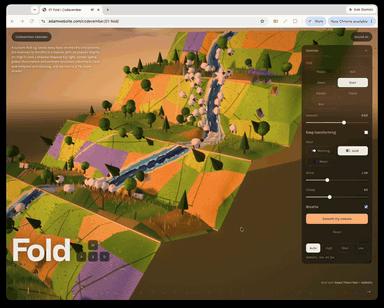

# Day 1: Fold

[Try it live](https://adamwebsite.com/codevember/01-fold/)

A strip of countryside printed on a paper map, with a river and a flock of sheep. Fold it along its creases and the land folds with it.

## How to play

Grab a gold crease and pull the way its arrows point. Drag anywhere else to look around. Pick up a sheep.

Run it locally with `npm run dev` from the repo root, then open <http://localhost:3000/01-fold/>.

## Technical overview

### Simulation

- A custom fold rig, with no physics engine, solves up to 256 flat facets on the CPU every frame.
- Up to 160 sheep walk the sheet in its own flat coordinates, climbing walls and falling under gravity when a face turns down.

### Shaders

- Facet matrices stream to the GPU in a 256 by 6 float DataTexture, read per vertex with textureLoad in TSL.
- The river shader bends its normal using two layers of moving mx_noise, with Fresnel sky reflection and foam where it crosses folds.

### Rendering

- Up to 42,000 instanced grass blades sway in TSL wind and follow their facet as it folds.
- Land and paper back are 2048 pixel canvas-painted survey maps, with the grass taking its colour from the land map.

### Optimisations

- A 48 by 26 spatial grid speeds facet lookups when seating grass, props and sheep.
- Grass count drops from 42,000 to 28,000 or 8,000, and families only swap while the sheet lies flat.

Everyone whose work Codevember builds on is listed in [CREDITS.md](../CREDITS.md).
