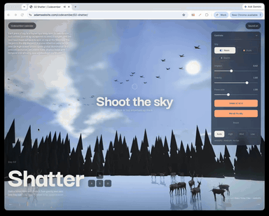

# Day 2: Shatter

[Try it live](https://adamwebsite.com/codevember/02-shatter/)

The sky is a sheet of glass. Break it, and the pieces fall onto a frozen lake where deer wander between them.

## How to play

Grab a fallen piece and throw it. Turn gravity past zero and they rise.

Run it locally with `npm run dev` from the repo root, then open <http://localhost:3000/02-shatter/>.

## Technical overview

### Rendering

- The sky dome is cut into spherical Voronoi cells, up to 300 extruded plates on High, all in one merged draw call.
- Each vertex finds its plate's live position and rotation in a float DataTexture, read in the vertex shader with textureLoad.

### Physics

- Each released plate becomes a Rapier dynamic rigid body with a convex hull collider built from its own corners.
- Deer cast Rapier rays a stride ahead to step onto low fallen plates and walk around tall ones.

### Shaders

- A TSL night sky behind the dome paints hashed twinkling stars, a noise-driven Milky Way, a swaying aurora and a moon.
- The deer walk, nod, graze and flick their tails entirely in the vertex shader, driven by a per-vertex rig attribute.

### Optimisations

- Sleeping rigid bodies are skipped each frame, and the state texture only uploads when something moved.
- Each deer's pose, axes, motion and style share one 13-float interleaved instance buffer, inside WebGPU's eight-buffer limit.

## Credits

The deer's skin uses Paul Bourke's marching cubes tables, as three.js publishes them.

Everyone whose work Codevember builds on is listed in [CREDITS.md](../CREDITS.md).
