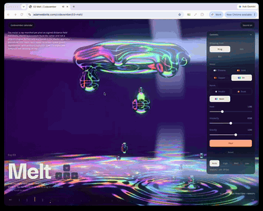

# Day 3: Melt

[Try it live](https://adamwebsite.com/codevember/03-melt/)

Liquid metal swelling and dripping from a ring into a mirrored pool. Pull the drops around and watch them merge and splash.

## How to play

Grab the metal and carry it around, or pull a drop off and throw it. Tap the mirror to splash it.

Run it locally with `npm run dev` from the repo root, then open <http://localhost:3000/03-melt/>.

## Technical overview

### Rendering

- The metal is ray-marched per pixel inside a 100-unit back-faced sphere, not drawn as meshes.
- Up to 30 metaball spheres plus the source are blended with Inigo Quilez's polynomial smooth minimum.

### Simulation

- Hanging drops grow until they let go, trailing a three-sphere strand that necks and snaps into a droplet.
- Touching drops attract, and the larger swallows the smaller while conserving volume and momentum.

### Lighting and materials

- Reflections are traced in-shader with a second march, hitting other metal or a procedural HDR room.
- Four metals: Fresnel-tinted chrome, gold and copper, plus a thin-film oil whose colour shifts with viewing angle.

### Optimisations

- Rays start and stop at an analytic bounding sphere of radius 9, skipping empty space entirely.
- Quality tiers set march steps (60/42/28), bounce steps (22/14/off) and blob capacity (30/22/14).

Everyone whose work Codevember builds on is listed in [CREDITS.md](../CREDITS.md).
