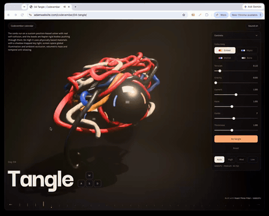

# Day 4: Tangle

[Try it live](https://adamwebsite.com/codevember/04-tangle/)

Lacquered cords knotted together in a beam of light. Pull any loose end and the whole tangle answers.

## How to play

Pull a cord. Throw a bead.

Run it locally with `npm run dev` from the repo root, then open <http://localhost:3000/04-tangle/>.

## Technical overview

### Simulation

- A custom position-based dynamics solver in plain TypeScript runs 7 cords of 320 particles each by default.
- True self-collision uses a 32,768-bucket spatial hash with diameter-sized cells, so knots cannot pass through each other.

### Physics

- Five metal beads are Rapier rigid bodies, and two-way coupling feeds cord push back as impulses on them.
- Cords are seeded as random torus knots, rotated by uniform random quaternions and resampled to equal arc length.

### Rendering

- Every cord is skinned into one 12-sided tube mesh with parallel-transported frames and rounded caps, drawn in one call.
- Tube vertices rebuild on the CPU each frame after one smoothing pass that removes collision zigzag.

### Shaders

- A TSL clearcoat physical material draws a woven twist in colour and roughness from per-vertex arc length.
- Last frame's tube positions are fed to the shader by hand so motion vectors stay correct.

## Credits

The cords follow Müller et al., *Position Based Dynamics* (2007).

Everyone whose work Codevember builds on is listed in [CREDITS.md](../CREDITS.md).
