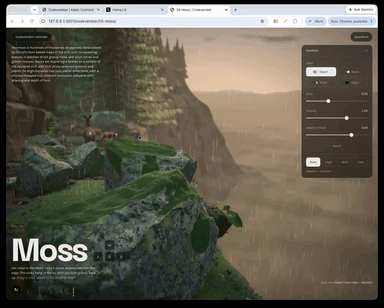

# Day 5: Moss

[Try it live](https://adamwebsite.com/codevember/05-moss/)

A mossy ledge high on a cliff, in the rain. Lean in close to the moss, or pick up a rock and send it over the edge.

## How to play

Get close to the moss. Carry a stone, or send one over the edge. The rocks hang in the air until you turn gravity back up.

Run it locally with `npm run dev` from the repo root, then open <http://localhost:3000/05-moss/>.

## Technical overview

### Rendering

- Moss is up to about 670,000 instanced fibres on High, in three grids of 6 mm, 18 mm and 65 mm cells.
- The fibre grids follow wherever the camera's line of sight first meets the cliff, found by a stepped ray march every other frame.

### Shaders

- TSL vertex shaders build every fibre from baked 520 x 520 float textures of cliff position and surface normal.
- Fibres never thin below roughly a pixel and fade to a shared colour beyond 1.2 m, which stops distant flicker.

### Physics

- Rapier boulders use convex hulls cut from their own procedural mesh and land on a 170 x 92 trimesh of the cliff.
- Dragging uses a coarse pick mesh plus a Rapier ray against fixed colliders, so rocks behind the cliff cannot be grabbed.

### Lighting and materials

- Pools use a planar reflector at 0.45 resolution, with rain rings from a hashed cell grid perturbing it.
- Reflections see cheap stand-in moss on their own layer, because the real fibres are too many to draw twice.

## Credits

The scanned rock and moss are CC0, from [Poly Haven](https://polyhaven.com) and [ambientCG](https://ambientcg.com). See [`public/assets/05-moss/CREDITS.txt`](../public/assets/05-moss/CREDITS.txt).

Everyone whose work Codevember builds on is listed in [CREDITS.md](../CREDITS.md).
