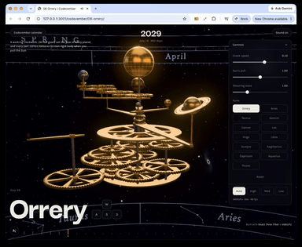

# Day 6: Orrery

[Try it live](https://adamwebsite.com/codevember/06-orrery/)

A working clockwork solar system in brass, set to today's date. Turn the crank to run the years, or pull the Sun and the machine comes apart.

## How to play

Turn the crank, or any wheel or planet, and the whole train answers. Pull the Sun to tear it apart and light the constellations. Let go and it comes back together. Tap a sign on the zodiac below.

Run it locally with `npm run dev` from the repo root, then open <http://localhost:3000/06-orrery/>.

## Technical overview

### Simulation

- A 26-gear train in 13 meshed pairs sets every planet's speed from its real tooth counts.
- Planets open at today's positions, from J2000 mean longitudes, and a sun gear drives the Moon's train on Earth's arm.

### Physics

- Pulling the Sun turns every part into a Rapier rigid body with zero gravity, keeping the spin it had.
- Parts start as ghost collision groups and turn solid once clear, so threaded gears never explode apart.

### Shaders

- Gears use true involute tooth profiles, extruded with spoke windows and merged with lathe-turned collars.
- Planets are procedural: Worley craters for Mercury, Mars and the Moon, fractal-noise land on clearcoated Earth.

### Rendering

- The Milky Way and six galaxies are painted once into a half-float cube map, 1536 or 768 per face.
- Up to five procedural star grid layers plus two flickering layers are hashed per pixel on the dome.

## Credits

The constellations are Olaf Frohn's [d3-celestial](https://github.com/ofrohn/d3-celestial) line figures (BSD 3-Clause, see [`d3-celestial-LICENSE.txt`](d3-celestial-LICENSE.txt)). Planet figures are from NASA's Planetary Fact Sheet.

Everyone whose work Codevember builds on is listed in [CREDITS.md](../CREDITS.md).
