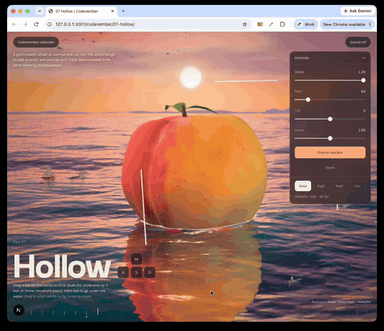

# Day 7: Hollow

[Try it live](https://adamwebsite.com/codevember/07-hollow/)

A giant peach, afloat at sunrise and cut live. The stone hangs by wet strands, and you can pull it out. Waves ported from Ultra Water by Humpalumps.

## How to play

Drag a bar on the frame to slice. Grab the stone and rip it out, or throw the whole peach. Orbit low to go under the water.

Run it locally with `npm run dev` from the repo root, then open <http://localhost:3000/07-hollow/>.

## Technical overview

### Simulation

- Tessendorf FFT ocean ported from Ultra Water: JONSWAP spectra in up to three 256x256 cascades, run as WebGPU compute shaders.
- The stone hangs on up to 84 strands of 13 Verlet points each, solved in 5 pull-only constraint rounds so they sag.

### Shaders

- The juice is ray-marched per pixel in TSL: up to 27 spheres merged with Inigo Quilez's polynomial smooth minimum, 30 steps.
- Slicing is a shader mask: every material discards past the blade plane, and one quad shades the cut face from signed distances.

### Lighting and materials

- A planar reflector mirrors boats, city and peach at a quarter to half resolution; fuzz, juice and drops sit on an unreflected layer.
- Underwater, Poly Haven CC0 scans and an instanced reef of up to 1,900 grass tufts and 340 kelp take distance-based colour absorption.

### Optimisations

- One 96-cubed baked 3D noise texture, with Worley cells and soft noise, replaces per-pixel noise in every shader.
- Above-water and below-water sea materials draw only when visible, and the quality tier is fixed at load to avoid shader rebuilds.

## Credits

The waves are ported from [Ultra Water](https://github.com/Humpalumps/Ultra-Water) by [Humpalumps](https://github.com/Humpalumps), under the MIT license, included in full at [`ultra-water-LICENSE.txt`](ultra-water-LICENSE.txt). The sea floor scans are CC0, from [Poly Haven](https://polyhaven.com), and the fish is the CC0 [Barramundi Fish](https://github.com/KhronosGroup/glTF-Sample-Assets/tree/main/Models/BarramundiFish) by Microsoft, from the Khronos glTF Sample Assets. See [`public/assets/07-hollow/CREDITS.txt`](../public/assets/07-hollow/CREDITS.txt).

Everyone whose work Codevember builds on is listed in [CREDITS.md](../CREDITS.md).
