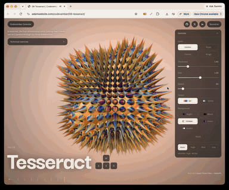

# Day 8: Tesseract

[Try it live](https://adamwebsite.com/codevember/08-tesseract/)

A tesseract, the four-dimensional cube, turning itself inside out as it passes through our three dimensions.

## How to play

Drag to push it through the fourth dimension.

Run it locally with `npm run dev` from the repo root, then open <http://localhost:3000/08-tesseract/>.

## Technical overview

### Rendering

- React Three Fiber and three.js r184 on the WebGPU renderer. There are no meshes or models: one inside-out sphere fills the screen.
- Its pixel shader, written in TSL and compiled to WGSL, ray marches signed distance fields for every pixel.

### The fourth dimension

- The tesseract lives on the 3-sphere, turned by a 4×4 matrix, then brought down by stereographic projection, so straight edges arrive as circles.
- Folding by symmetry turns 32 edges into 4 arcs and 16 joints into 1, so each step tests only a handful of shapes.

### Forms

- Fractal: a Mandelbulb in every joint, its power drifting between about 5.4 and 8.6, worked out once thanks to the fold.
- Urchin: 16 metaballs smooth-unioned into one mass, with needles on a grid wrapped around it, each breathing on its own.

### Optimisations

- Sums of squared differences replace 2 − 2cos, which removed a speckle caused by lost float precision on far tubes.
- Colour and background change through uniforms without recompiling; Auto lowers resolution first, then quality, never below Medium.

Everyone whose work Codevember builds on is listed in [CREDITS.md](../CREDITS.md).
