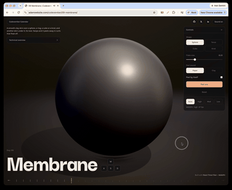

# Day 9: Membrane

[Try it live](https://adamwebsite.com/codevember/09-membrane/)

A smooth clay skin over a sphere, a ring, a cube or a knot, and another skin under it, for ever. Swipe and it peels away in curls that float off.

## How to play

Swipe across the skin to peel it off as fast as you move. Click it for a slow ripple.

Run it locally with `npm run dev` from the repo root, then open <http://localhost:3000/09-membrane/>.

## Technical overview

### Rendering

- React Three Fiber and three.js r184 on the WebGPU renderer, with every surface a TSL node material.
- Lit by a soft studio of light boxes baked into an environment map, plus one shadow-casting key light.

### Peeling

- Each tile bends in the vertex shader: past the fold it rolls over a cylinder, then carries on straight, with its normals turned by hand.
- A swipe sets how fast each tile comes off and how hard it is thrown; a click sends a slow ripple out from where it landed.

### Floating

- Each tile turns grey as it rolls over, darker if its layer is light and lighter if it is dark.
- Loose tiles fall like leaves, swaying as they go, slide off the slippery glaze and settle on the floor before they sink away.

### Optimisations

- Two instanced meshes draw every tile and the layer under it; per-tile fold, lift and layer go in instance attributes each frame.
- Every layer is printed with the next one's colours underneath, so nothing runs out: a spent tile simply becomes the layer below.

Everyone whose work Codevember builds on is listed in [CREDITS.md](../CREDITS.md).
