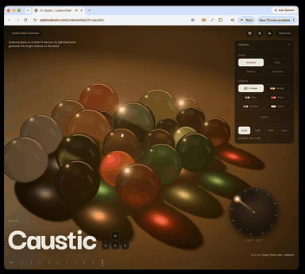

# Day 10: Caustic

[Try it live](https://adamwebsite.com/codevember/10-caustic/)

Coloured glass on a table in low sun, its light bent and gathered into bright colours on the wood.

## How to play

Drag the glass about to push the pieces around, and turn the dial to move the sun.

Run it locally with `npm run dev` from the repo root, then open <http://localhost:3000/10-caustic/>.

## Technical overview

### Rendering

- React Three Fiber and three.js r187 on the WebGPU renderer, with every surface a TSL node material. The glass is physical transmission with dispersion, tinted by absorption through its thickness.
- Every study is built while the page first loads, out of sight, so its shaders are ready before it is chosen and switching is quick.

### Caustics

- Light is a mesh, after Evan Wallace: a grid held square to the sun, one ray per vertex, traced through the glass in the vertex shader to where it lands. Where rays crowd together their triangles shrink, and a triangle's area before over its area after is how bright the light is there.
- Marbles, orbs and blocks are traced exactly, by ray-sphere and ray-box formulas, bouncing off any face met too steeply. Each colour band bends a little more than the last, so the light splits into a spectrum at its edges.
- Suzanne has no formula, so each frame she is drawn from the sun into two maps, her near side and her far side, each holding the surface's normal and depth. A ray bends where it enters, walks the far map to find where it leaves, and bends again on the way out.
- All the light is added into one map of the table seen from above, softened, and read back by the table. It is only worked out again when a piece or the sun moves.

### Glass on the table

- The pieces slide and roll on a shallow pull towards the middle and knock into each other, mass going as the cube of size. Suzannes lie as they came to rest when dropped in Rapier, and collide by a few circles along their outline rather than one around the whole.
- The dial turns the sun around the table, clicking as it goes, and the colourways retint the glass and its light without rebuilding a shader.

Everyone whose work Codevember builds on is listed in [CREDITS.md](../CREDITS.md).
