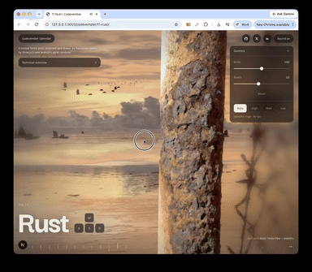

# Day 11: Rust

[Try it live](https://adamwebsite.com/codevember/11-rust/)

A rusted fence post, scanned and drawn as Gaussian splats by three.js's own WebGPU splat renderer.

## How to play

Drag to look around the post.

Run it locally with `npm run dev` from the repo root, then open <http://localhost:3000/11-rust/>.

## Technical overview

### 3D capture

- The post is a real one, on a beach, captured by walking around it with a phone in the Polycam app. Its video is broken into hundreds of frames, and structure from motion finds where the camera stood for each one, and a sparse cloud of points the frames agree on.
- From that start, 3D Gaussian splatting trains the scene: millions of soft, coloured, see-through ellipsoids, each nudged in position, shape, colour and opacity until, drawn from every camera's place, they reproduce its frame. The same method runs in open tools such as Nerfstudio's Splatfacto.
- The result is saved as SPZ, a compressed splat format, 12 MB for 875,000 Gaussians. The beach behind is a second splat scene, made from a single photograph of a sunset.

### Rendering

- React Three Fiber and three.js r187 on the WebGPU renderer. The splats are loaded from SPZ and drawn by three.js's own GaussianSplat, written in TSL.
- About 1.5 million Gaussians are drawn on the GPU each frame: around 340,000 kept of the post scan's 875,000, and 1.18 million in the beach. They are depth-sorted every frame by a compute counting sort.
- As the scan loads it is cropped to a cylinder around the post, its edge faded out, and stray sky and floating blobs are dropped by colour and size. A solid core hidden inside the post stops what passes behind from showing through its thinner splats.

### Sea and sky

- The water is Day 7's Tessendorf FFT ocean, ported from Ultra Water, mirroring the scene and thinning with distance into the photograph's own sea. A wash of foam runs up the sand at the photograph's surf line.
- Sailboats, fishing boats and flocks of gulls are instanced meshes, the gulls' wings flapped and glided in the vertex shader. A sheet of cloud drifts overhead, and the camera floats as if held.
- Splats write no depth, so depth of field cannot read them: the soft edges of the frame are a screen-space blur instead.

Everyone whose work Codevember builds on is listed in [CREDITS.md](../CREDITS.md).
