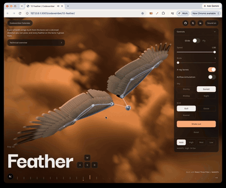

# Day 12: Feather

[Try it live](https://adamwebsite.com/codevember/12-feather/)

A pair of bird's wings built from the bone out: a skinned skeleton you can pose, and every feather on the bone it grows from.

## How to play

Drag a wing to fold and open it. Grab the ball at the neck to carry the body while the wingtips stay put. Switch to Fly to see it beat its wings.

Run it locally with `npm run dev` from the repo root, then open <http://localhost:3000/12-feather/>.

## Technical overview

### Research

- The skeleton follows a gull's: humerus, ulna and carpometacarpus in the proportions measured in Hayward et al.'s study of glaucous-winged gull wing bones (Journal of Morphology, 2009). Each bone is modelled with its landmarks: the humeral head, deltopectoral and bicipital crests and pneumatic opening; the olecranon and the quill knobs on the ulna; the extensor process and the open space of the carpometacarpus; the bladed first phalanx.
- Elbow and wrist are coupled as in Vazquez's account of the automatic linkage in the avian wing (Zoomorphology, 1994): the radius slides along the ulna, so the wing cannot open at one joint without the other. One value, how far the wing is open, drives both.
- Feather tracts follow standard topography (Proctor and Lynch, Manual of Ornithology, 1993): ten primaries on the hand, secondaries one to a quill knob, tertials by the elbow, and coverts in overlapping rows, greater, median, lesser and marginal, each over the row behind it.
- The wingbeat follows high-speed studies of flapping flight (Tobalske and Dial, Journal of Experimental Biology, 1996): spread and pronated on the downstroke, swept forward; on the upstroke the wrist flexes and the hand supinates, and the tip traces a loop. Gull wingtip patterns follow the primary studies at gull-research.org.

### Skeleton and skin

- Each wing is a three-bone chain on a three.js skeleton. The skin is a skinned mesh bound to it, each ring weighted to its bone and blended across the joints so it bends rather than breaks; a web of skin from shoulder to wrist, reshaped every frame, makes the rounded leading edge.
- Dragging a wing is inverse kinematics: it finds the opening and the sweep at the shoulder that put the point you hold under the cursor, and the joints follow on springs. In a wingbeat each joint also lifts and twists out of the wing's plane, the forearm and hand trailing the shoulder.
- The bones are lathed from profiles, with crests, condyles and processes placed round each one, and drawn as an x-ray through everything: additive, brightest where the surface turns away.

### Feathers

- About 330 feathers a wing in four instanced meshes, each placed every frame on the bone or the patch of skin it grows from. Folding turns the flight feathers in along their bones and slides them under one another; the hand tucks under the forearm.
- One TSL material draws every feather: barbs, the gaps and splits between them, ragged ends, down at the base, fringes, bands and flecks. Each feather has a few random numbers of its own, so its shade, pattern, wear and width differ a little from its neighbours'.
- Every feather is sprung in lift, twist and bend, driven by the air moving past it: the cursor's breeze and the wing's own motion.

### Flight and the flock

- Gliding, the wings hold a gull's bent M and breathe a little, the body riding up and down on the air. Flying, each beat runs through the joints in turn, and the wing's bend eases between stroke and recovery on damped springs. Speed slows the bird, the air and the clouds together.
- Up to four more birds follow in a loose V, each a wingspan to the side and well back so no two wings can meet. Each drifts about its place and now and then beats its wings for a few strokes, on its own clock, out of step with the rest.

### Airflow simulation

- Each wing is a lifting surface in a vortex lattice: a vortex bound along its bones, and behind it a wake of vortex rings, one for each moment of the wing's past, each as strong as the wing was lifting then. A glide sheds two trailing vortices from the tips; a wingbeat, lifting on the way down and hardly at all on the way up, sheds a chain of rings.
- The air's velocity anywhere is the sum of every segment's Biot–Savart contribution, worked on the CPU within a budget of lookups a frame. It is shown as streamlines coloured as a CFD plot colours speed, or as the vortex filaments themselves with particles shed from the trailing edge.

### Sky

- The clouds are raymarched through a slab of air from a tiling 3D noise baked once: Perlin–Worley billows for their shape, finer Worley to fray their edges. Light reaching each sample is dimmed by the cloud toward the sun (Beer–Lambert) and scattered toward the eye by a two-lobe Henyey–Greenstein phase.
- The march runs at half resolution with a jittered start, blended over the frames before through reprojection, so it stays smooth while it streams past at the bird's airspeed. Stormy, Sunset, Midday and Night share the same clouds and change only the light and colour, eased from one to the next.

Everyone whose work Codevember builds on is listed in [CREDITS.md](../CREDITS.md).
