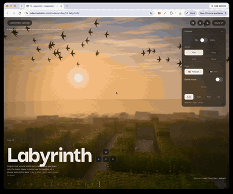

# Day 13: Labyrinth

[Try it live](https://adamwebsite.com/codevember/13-labyrinth/)

A hedge maze without end that never stops rebuilding itself.

## How to play

Drag to look around, WASD to fly. Walk takes you down into the maze, Space to jump over the hedges; on a phone, hold still to walk.

Run it locally with `npm run dev` from the repo root, then open <http://localhost:3000/13-labyrinth/>.

## Technical overview

### The maze

- A perfect maze, one with exactly one way between any two cells, generated on a 40 by 40 torus and laid over the ground again and again, so it reaches past the mist in every direction and has no edge to run into. Flying further than one copy carries the camera, and everything round it, back by one, so it can go on for ever.
- It rewrites itself one loop at a time. Taking a wall out of a perfect maze always makes exactly one loop, and putting back any other wall on that loop makes a perfect maze again, so the maze is never broken, only ever different. Walls sink into the earth and others grow back out of it every few seconds, near where you are looking.
- How far up each wall stands is kept every frame: the hedges are drawn from it, walking bumps into it, and the coins and rabbits read it to know where a hedge stands.

### Hedges and what grows on them

- Every wall and post is one instance of a box, close up finely made, with a TSL material that lays clipped leaves over its faces from noise, lumps and thin patches of its own, and lifts the surface along them. Far off, where a leaf is smaller than a pixel, only the colour the leaves make is kept.
- Near the camera each hedge is dressed with cards drawn on the same instances: loose leaves standing out of it, new shoots, ivy, bindweed, bramble and clematis climbing over it, grass and fallen leaves at its foot, and stones along its edge. One material cuts every kind of card to its own shape; each hedge rolls its own dice for which pieces show, so no two are alike. Only hedges in or near the view are dressed.
- Pebbles and dropped leaves lie on the gravel in a grid that repeats with the maze, so nothing on the ground seems to move as you do. Fireflies drift low along the paths, swifts wheel overhead in flocks, and white rabbits hop from cell to cell wherever no hedge stands between.

### Bent worlds

- Every surface is lit, shadowed and misted where it really lies, on flat ground, and only drawn somewhere else: at the last step before the screen each point is carried, relative to the eye, to where the chosen world puts it. So the bend goes wherever the camera goes, without end, and shadows stay in the flat world they are looked up in.
- Ring runs the maze round the inside of a hoop eight copies round, so it carries straight on overhead. Fold turns it up a hinge into walls all round that lean in at the top. Twist turns it over about the line of sight, half a turn every 70 metres, like a ribbon. Motion vectors carry the bend too, so the temporal anti-aliasing holds through it.

### Light and air

- A low evening sun with shadow maps, bounce light and occlusion traced in screen space, and a volume of mist lying thickest in the paths, gathered in its own pass and blurred over the frame. Depth of field softens the far maze and bloom takes the fireflies.
- Tron draws the same maze, rewriting itself the same way, in another manner: lines of light along every edge, reflections traced along the maze's own walls, chips, traces, panels, cables and masts on the hedges, and craft and packets of light going round in the sky.

### Walking, flying and the game

- Fly over it, or walk down into it: walking collides with the hedges as they stand that frame, with a jump over them and a damped rise back out. Sprinting widens the view and streaks the edges of the frame, and the camera always hovers a little, flying or walking.
- Game mode lays coins down every path and along every hedge top, a little over half a metre apart, and the rabbits run from you and can be caught for more. The count is kept in the browser; every tenth and hundredth coin brings up a card from the foot of the screen.
- Every sound is synthesised in Web Audio: an evening of wind, crickets and birdsong with gravel underfoot, or a hum, shimmer and relay clicks over the ringing grid in Tron, and a coin's ding that climbs the scale while they keep coming.

Everyone whose work Codevember builds on is listed in [CREDITS.md](../CREDITS.md).
