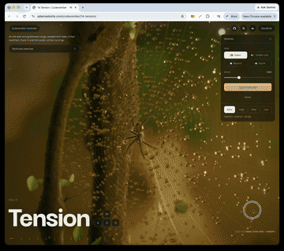

# Day 14: Tension

[Try it live](https://adamwebsite.com/codevember/14-tension/)

An orb web strung between twigs, beaded with dew, in four weathers. Pluck it and the spider comes running.

## How to play

Pull a thread and let it go. Pull too far and it snaps.

Run it locally with `npm run dev` from the repo root, then open <http://localhost:3000/14-tension/>.

## Technical overview

### The web

- Spun the way a garden spider spins one: frame threads tied to twigs, spokes from the hub out to the frame, a tight mesh at the hub, then the sticky spiral wound outward, spaced wider below the hub than above. Every crossing is a point the silk can move at, and every length of silk between two is a thread.
- It moves by position-based dynamics on the CPU: each frame, in two substeps, points carry on from where they were, then every thread is pulled back toward its length a number of times over, pulling when stretched and going slack when not. The web is hung and left to settle before it is shown, so it starts at rest in its own sag.
- Pull a thread and let it go and the web rings; pull too far and the thread snaps and its ends spring back. Only a press right on the silk takes hold, judged by angle so it is the same on screen however far off the web is; a press in the gaps turns the view.

### Silk and dew

- Each thread is a strip turned to face the eye, never thinner than about a pixel and fainter by however much it had to be widened, so far threads stay fine. Silk is all in how it takes the light: a soft sheen across it and, where a thread lies just right between the eye and the light, a hard glint split into colours, as the fine ridges on real silk split it.
- Beads of dew sit along the sticky spiral, each an instanced tiny ball lens: through it the garden behind shows small and upside down, its rim mirrors the sky, and where it lines up with the sun it gathers the light into a burning point. Their weight drags the web down where they hang thickest, and a hard enough shake throws them off; in time new ones gather.

### The spider

- Built and moved like the real animal: each leg is coxa, femur, patella, tibia, metatarsus and tarsus, solved every frame so the knee rides high and the foot comes down steeply to grip a thread, and rides that thread as the web swings.
- She walks in an alternating tetrapod, legs one and three of one side with two and four of the other, runs in dashes with sudden freezes, feels about with her palps when she stops and sits head down at the hub. Pluck the web and she finds her way along the silk to it.

### The tree, the light and the weather

- The twigs are grown through the points the frame is tied to: tapering limbs swelling at knots and forks, side twigs ending in buds and leaves. Their bark is a CC0 scan from Poly Haven wrapped round each limb and pushed in by its own heights, then crusted with lichen, and wet in the storm. Leaves have their outline, teeth, veins and insect bites in the shader and glow through when backlit.
- Four weathers: dawn with motes in the low sun, a golden silk spider's web among pollen, moonlight with fireflies, and a storm of rain and lightning. Behind the web is a dome of out-of-focus garden and bokeh; dew, silk and bark all take their light from it, and changing weather glides rather than rebuilds. What drifts in the air moves on the GPU; depth of field and bloom finish the macro look.
- Sound: birds at dawn, insects in the golden web, crickets and an owl by moonlight, rain and thunder in the storm, all synthesised in Web Audio, with the silk singing higher the further it is drawn and plucking when let go, over a music track.

Everyone whose work Codevember builds on is listed in [CREDITS.md](../CREDITS.md).
