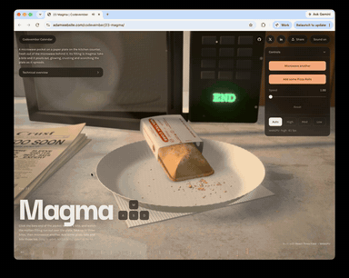

# Day 23: Magma

[Try it live](https://adamwebsite.com/codevember/23-magma/)

A microwave pocket on a paper plate on the kitchen counter, fresh out of the microwave behind it. Its filling is magma: take a bite and it pours out, glowing, crusting and scorching the plate as it spreads.

## How to play

Click the bare end of the pocket to take a bite, and watch the molten filling run out over the plate. Take up to three bites, then microwave another. Add some pizza rolls and bite those too.

Run it locally with `npm run dev` from the repo root, then open <http://localhost:3000/23-magma/>.

## Technical overview

### The pocket

- Pastry built at load as puffed top and flat bottom sheets over shared rings, sealed by a flat pressed edge; it rests tilted, sleeve on the rim.
- A bite is a scalloped circle the shader cuts away, so no mesh is rebuilt; the cut shows crumb and the glowing inside.

### The lava

- A 256 × 256 thin-film flow on the CPU: lava moves by surface slope × depth³ × a fluidity that falls steeply as it cools.
- Heat rides with the flow and leaks from the top, so fronts stall in a crust and hot lava breaks out behind them.
- Drawn as a displaced grid: incandescent by temperature, then ropy crust drifting with the flow, cracked to show the glow.

### Pizza rolls

- Rapier bodies, each a small hull of the pillow shape, fall onto a trimesh of the plate and a hull of the pocket, then freeze.
- Settled rolls are raised into the lava's floor, so a bitten one's filling runs from its cut over the rolls below and down to the plate.

### Plate, crumbs and counter

- The plate scorches brown to black wherever hot lava has lain, from a heat map the flow writes as it goes.
- Crumbs are one mesh of noise-shaped pieces; lava sets them alight from a pool of flames and lights, and they char, glow and fall to ash.
- The kitchen is captured once into a blurred cube the marble reflects; on High a planar mirror adds the plate and lava.

Everyone whose work Codevember builds on is listed in [CREDITS.md](../CREDITS.md).
