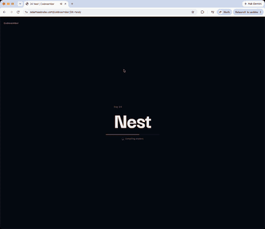

# Day 24: Nest

[Try it live](https://adamwebsite.com/codevember/24-nest/)

A cold nest on a snowy branch at dusk, and a smart thermostat screwed to the tree. Turn it up and watch the snow melt and the chicks thaw out. Leave it alone and it goes Away, turning itself back down.

## How to play

Turn the dial to warm the nest: drag round the ring, or scroll over it. Drag anywhere else to look around.

Run it locally with `npm run dev` from the repo root, then open <http://localhost:3000/24-nest/>.

## Technical overview

### The dial

- One number drives the whole scene: the room's temperature, easing after the set one. Snow, frost, wet, light, snowfall and the chicks' mood all follow it through shared uniforms, so turning the dial changes no geometry and compiles nothing
- The display is drawn by its shader from a sheet of glyphs painted once at load: digits, ticks lit from the room's temperature to the set one, HEATING or a leaf
- Left alone, it goes Away: the word blinks, then the dial turns itself back to the coldest setting the way a hand would, clicking through its detents, and the whole scene follows it

### Snow and melt

- Snow lies as a second draw of each limb, the nest's rim and the dial's ring, pushed out along the normals by how upward they face and patchy noise; as it melts the caps thin and break up
- Meltwater drips are one instanced draw, swelling and falling in the vertex shader

### Nest and chicks

- The nest is a couple of hundred bark-scanned twigs and fifteen hundred grass strands wound round the cup, merged into a handful of draws
- The chicks' down grows in tufts of fine barbs, each a camera-facing ribbon; puffed out in the cold, sleek in the heat

Everyone whose work Codevember builds on is listed in [CREDITS.md](../CREDITS.md).
