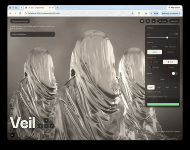

# Day 25: Veil

[Try it live](https://adamwebsite.com/codevember/25-veil/)

Three veiled statues, close, before a world gone to soft light, their cloth swaying slowly in a calm breeze. The figure is built from a depth map; pick its stone and the light behind it, or switch on Glitch and watch them mosh between materials.

## How to play

Drag to orbit, scroll or pinch to zoom, and WASD to fly. In the panel, move the Sun, pick a Material (Carrara, Nero Marquina, Glass or Obsidian) and a Background, or turn on Glitch.

Run it locally with `npm run dev` from the repo root, then open <http://localhost:3000/25-veil/>.

## Technical overview

### Cloth in Blender

- Blender's cloth solver first draped sheets over a seated CC0 body, headless: pinned at the crown, colliding, baked offline.
- None held the wrapped layers we wanted, so the front was built from a depth map; the unseen back is a cloth sim on a shell.
- A 5 mm cloth sim in a slow breeze, its folds kept whole, baked as a 14 s loop into a GPU texture the vertex shader reads.

### Structure from a depth map

- MoGe-3 ViT-G gives metric depth and normals for the front; smoothed along its folds, not across, and deepened where they read faint.
- The front ships as a 16-bit depth grid, built into a mesh in a worker off the main thread; phones build every other pixel.

### Stone, glass and light

- Marble, glass and obsidian are TSL nodes reflecting or bending a procedural room in the background's colours; the floor is the same.
- Behind them, Tension's recipe: a sky of soft blots and drifting bokeh, held out of focus by depth of field on the statues.
- Glitch moshes between materials: each is drawn behind one shared mask of macroblocks that corrupt, drift and decode wrong.

Everyone whose work Codevember builds on is listed in [CREDITS.md](../CREDITS.md).
