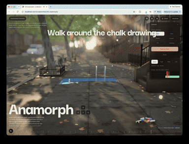

# Day 26: Anamorph

[Try it live](https://adamwebsite.com/codevember/26-anamorph/)

A chalk drawing of a swimming pool on a Brooklyn sidewalk. Walk round it, then tap it: the view sweeps through the one spot it was drawn for and, there, it becomes real.

## How to play

Drag to walk round the chalk drawing and scroll to step in or back. Tap the drawing and it becomes real; tap it again to turn it back to chalk. Pick another chalk painting in the panel and it is wiped off and the next drawn on.

Run it locally with `npm run dev` from the repo root, then open <http://localhost:3000/26-anamorph/>.

## Technical overview

### The chalk is a photograph

- Each painting is a real 3D scene; the chalk is a picture of it rendered from one eye point, projected flat onto the sidewalk.
- Taken at twice the view's resolution through the view's own lens, so at the spot the swap to 3D matches to about 3/255.
- Chalk strokes and eraser wipes sweep in arcs, kept inside each painting's outline by per-row spans worked out once.

### Six paintings, kept warm

- Pool, pit, lava, ocean, crystal and subway are all built once behind the loader, their shaders compiled under the sidewalk.
- The view eases through the spot and the painting turns real on that frame; going back, everything glides home as it sweeps in.
- Painting lights live on their own layer; the sun's shadow is redrawn only when something casting it moves.

### A Brooklyn block

- Brownstone stoops, parked cars, hoop racks and shops, with grime baked into every corner and thousands of instanced leaves.
- Depth of field keeps the drawing sharp and lets the block go soft; chalk and eraser sounds loop only while the tools move.

Everyone whose work Codevember builds on is listed in [CREDITS.md](../CREDITS.md).
