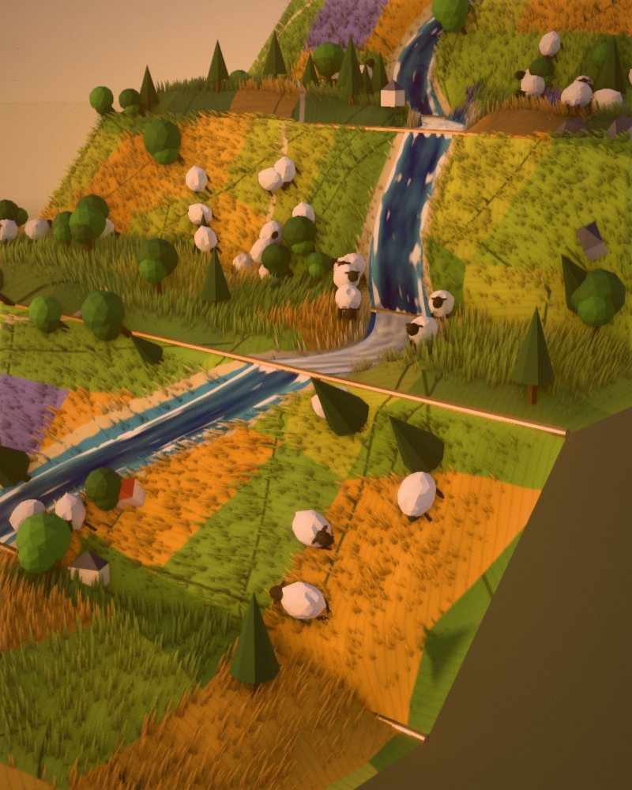
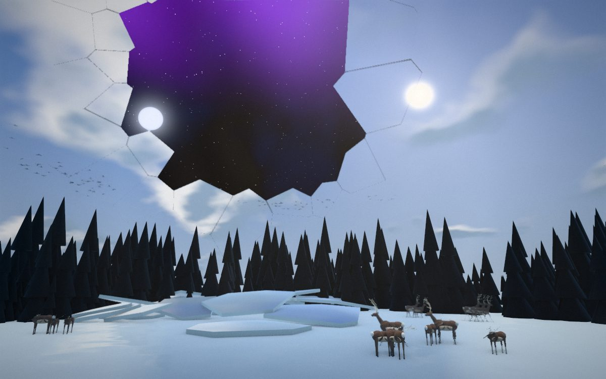
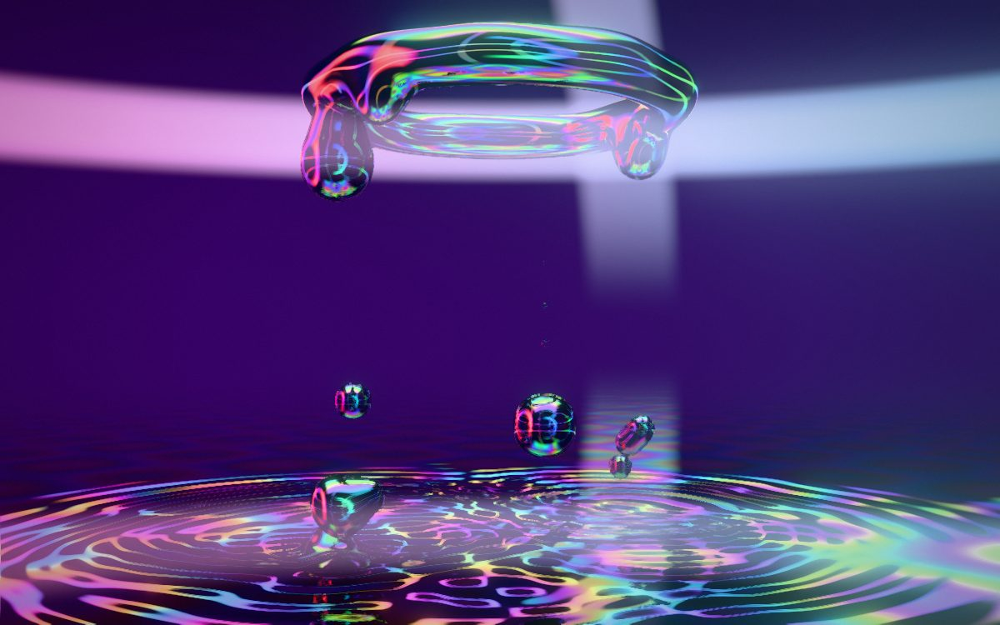
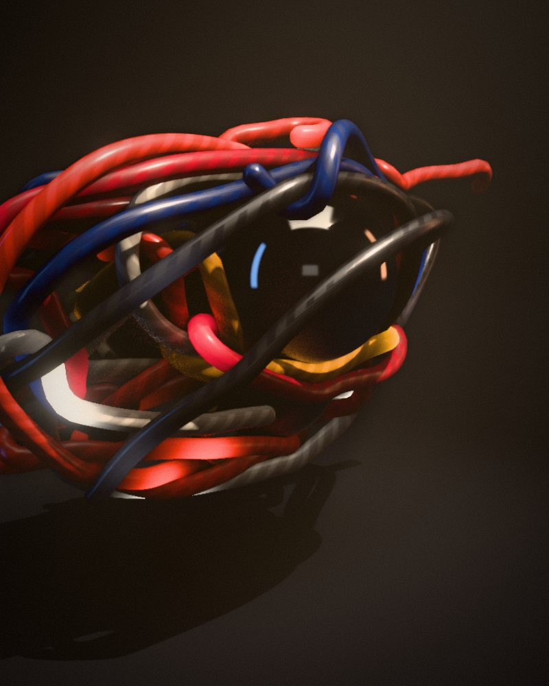
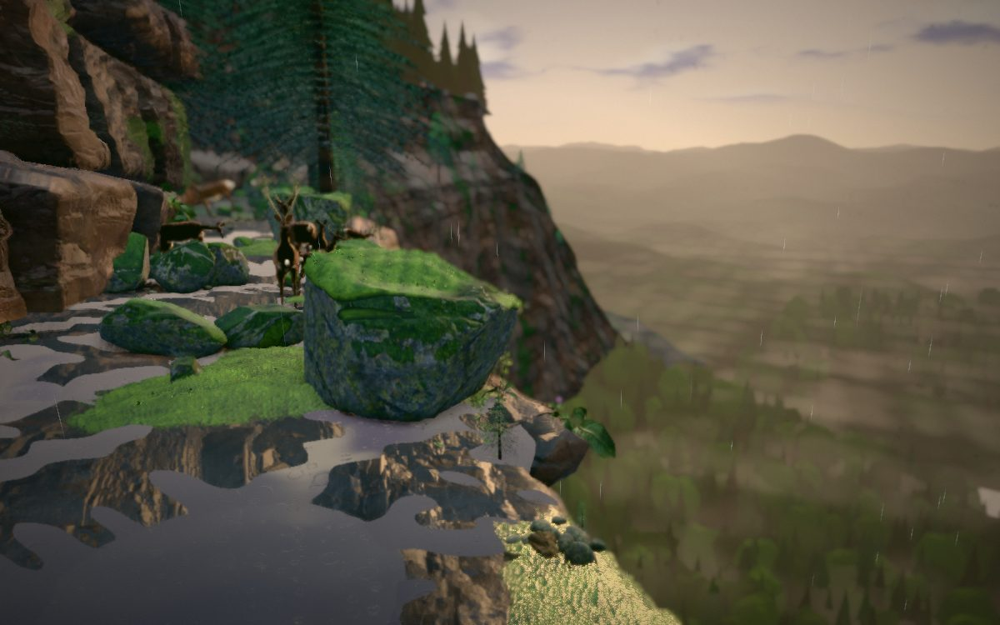

# Codevember 2026

Creating a fun, interactive three.js experience every day of November. One word, one real-time 3D scene you can grab, fly through and play with, all running in the browser on WebGPU.

<table>
  <tr>
    <td></td>
    <td></td>
    <td></td>
    <td></td>
    <td></td>
  </tr>
</table>

## Quick start

```bash
npm i
npm run build
npm start
```

Then open <http://localhost:3000>.

You need [Node.js](https://nodejs.org) 20.9 or newer, and a browser with WebGPU, such as a recent Chrome, Edge or Safari. Days fall back to WebGL2 where they can, with a simpler look.

## Days

| Day | Word | |
| --- | --- | --- |
| 01 | [Fold](01-fold) | A strip of countryside printed on a paper map. Fold it by its creases. |
| 02 | [Shatter](02-shatter) | Throw a stone at the sky and it comes down in pieces onto a frozen lake. |
| 03 | [Melt](03-melt) | Ray-marched liquid metal dripping into a mirror. Grab the metal and carry it around. |
| 04 | [Tangle](04-tangle) | A snarl of lacquered cord hanging in a shaft of light. Pull a loose end. |
| 05 | [Moss](05-moss) | A ledge on a cliff over a forest, deep in moss made of separate fibres. |
| 06 | [Orrery](06-orrery) | A clockwork solar system in brass, with every tooth of every gear doing its job. Turn the crank, pull it apart, drag the Sun and let the pieces chase it, or turn the whole machine into a constellation. |
| 07 | [Hollow](07-hollow) | A giant peach afloat at sunrise, with sharks circling below. Slice it open, then grab the stone and pull it out by its dripping strands. |

## Controls

| Input | Action |
| --- | --- |
| Drag | Orbit, or grab whatever is under the pointer |
| Scroll or pinch | Zoom |
| <kbd>W</kbd> <kbd>A</kbd> <kbd>S</kbd> <kbd>D</kbd> | Fly |
| <kbd>E</kbd> / <kbd>Q</kbd> | Up / down |
| <kbd>Shift</kbd> | Fly faster |
| <kbd>[</kbd> / <kbd>]</kbd> | Previous / next day |
| <kbd>H</kbd> | Hide the interface |

Every day also has its own settings panel, with quality settings that adapt to your GPU.

## Built with

- [three.js](https://threejs.org), with its WebGPU renderer and [TSL](https://github.com/mrdoob/three.js/wiki/Three.js-Shading-Language) shaders
- [React Three Fiber](https://r3f.docs.pmnd.rs), for the scene graph
- [Rapier](https://rapier.rs), through [@react-three/rapier](https://github.com/pmndrs/react-three-rapier), for physics
- [Next.js](https://nextjs.org), [React](https://react.dev) and [TypeScript](https://www.typescriptlang.org), for the site
- The Web Audio API for sound, all of it synthesised, with no audio files

## Project layout

```
01-fold/ ... 05-moss/   One directory per day
shared/engine/          Renderer, post-processing, camera, grabbing, boundaries, sound, settings
shared/ui/              Calendar, loading screen and on-screen controls
shared/days.ts          The 30 words, and which days are out
shared/registry.ts      Loads each day on demand
app/                    Next.js routes: the calendar at /, each day at /NN-word/
public/                 Calendar posters, and scanned textures and models
scripts/                Build helpers
```

## Scripts

| Command | What it does |
| --- | --- |
| `npm run dev` | Starts a development server with hot reloading |
| `npm run build` | Builds a static site into `out/`, which can be hosted anywhere |
| `npm start` | Serves the built site |
| `npm run typecheck` | Checks types |
| `npm run lint` | Runs ESLint |

## Adding a day

1. Build it in its own `NN-word/` directory, with a default export of a `DayDefinition`.
2. Add it to `shared/registry.ts`.
3. Add its blurb to `LIVE` in `shared/days.ts`.
4. Add a poster at `public/posters/NN-word.jpg`.

## Contributing

This is a personal daily challenge, so new days are mine to make, but bug reports and fixes are very welcome. Please open an issue first for anything large, and run `npm run typecheck` and `npm run lint` before sending a pull request.

## Credits

The scanned rocks, plants and moss are all CC0, from [Poly Haven](https://polyhaven.com) and [ambientCG](https://ambientcg.com). The ocean in Hollow is ported from [Ultra Water](https://github.com/Humpalumps/Ultra-Water) by Humpalumps (MIT). Everyone whose work this builds on is listed in [CREDITS.md](CREDITS.md).

## License

[MIT](LICENSE)
