# Codevember 2026

Creating a fun, interactive three.js experience every day of November. One word, one real-time 3D scene you can grab, fly through and play with, all running in the browser on WebGPU.

<table>
  <tr>
    <td align="center" valign="top">
      <a href="01-fold">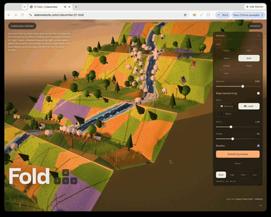</a><br>
      <b>Day 1: <a href="01-fold">Fold</a></b><br>
      <a href="01-fold">Code</a> · <a href="https://adamwebsite.com/codevember/01-fold/">Live</a>
    </td>
    <td align="center" valign="top">
      <a href="02-shatter">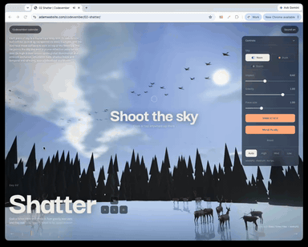</a><br>
      <b>Day 2: <a href="02-shatter">Shatter</a></b><br>
      <a href="02-shatter">Code</a> · <a href="https://adamwebsite.com/codevember/02-shatter/">Live</a>
    </td>
    <td align="center" valign="top">
      <a href="03-melt">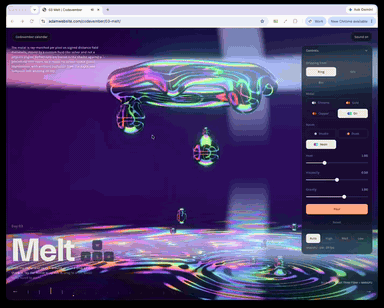</a><br>
      <b>Day 3: <a href="03-melt">Melt</a></b><br>
      <a href="03-melt">Code</a> · <a href="https://adamwebsite.com/codevember/03-melt/">Live</a>
    </td>
  </tr>
  <tr>
    <td align="center" valign="top">
      <a href="04-tangle">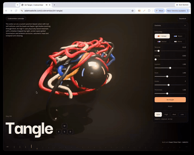</a><br>
      <b>Day 4: <a href="04-tangle">Tangle</a></b><br>
      <a href="04-tangle">Code</a> · <a href="https://adamwebsite.com/codevember/04-tangle/">Live</a>
    </td>
    <td align="center" valign="top">
      <a href="05-moss">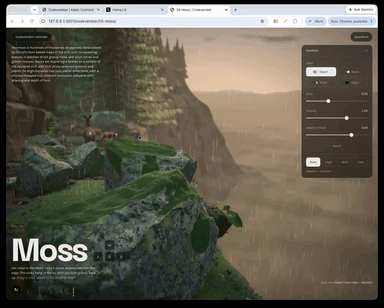</a><br>
      <b>Day 5: <a href="05-moss">Moss</a></b><br>
      <a href="05-moss">Code</a> · <a href="https://adamwebsite.com/codevember/05-moss/">Live</a>
    </td>
    <td align="center" valign="top">
      <a href="06-orrery">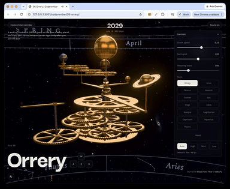</a><br>
      <b>Day 6: <a href="06-orrery">Orrery</a></b><br>
      <a href="06-orrery">Code</a> · <a href="https://adamwebsite.com/codevember/06-orrery/">Live</a>
    </td>
  </tr>
  <tr>
    <td align="center" valign="top">
      <a href="07-hollow">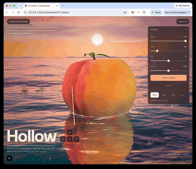</a><br>
      <b>Day 7: <a href="07-hollow">Hollow</a></b><br>
      <a href="07-hollow">Code</a> · <a href="https://adamwebsite.com/codevember/07-hollow/">Live</a>
    </td>
    <td align="center" valign="top">
      <a href="08-tesseract">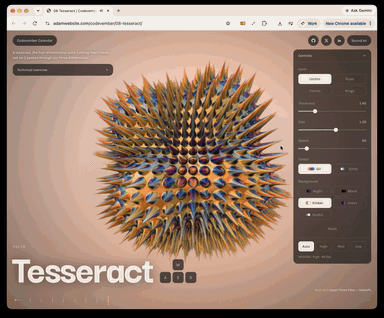</a><br>
      <b>Day 8: <a href="08-tesseract">Tesseract</a></b><br>
      <a href="08-tesseract">Code</a> · <a href="https://adamwebsite.com/codevember/08-tesseract/">Live</a>
    </td>
    <td align="center" valign="top">
      <a href="09-membrane">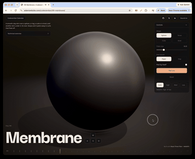</a><br>
      <b>Day 9: <a href="09-membrane">Membrane</a></b><br>
      <a href="09-membrane">Code</a> · <a href="https://adamwebsite.com/codevember/09-membrane/">Live</a>
    </td>
  </tr>
  <tr>
    <td align="center" valign="top">
      <a href="10-caustic">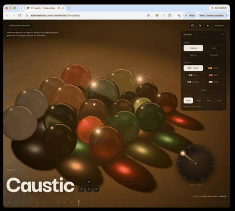</a><br>
      <b>Day 10: <a href="10-caustic">Caustic</a></b><br>
      <a href="10-caustic">Code</a> · <a href="https://adamwebsite.com/codevember/10-caustic/">Live</a>
    </td>
    <td align="center" valign="top">
      <a href="11-rust">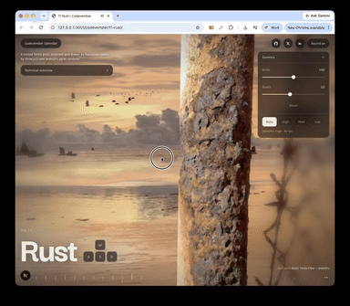</a><br>
      <b>Day 11: <a href="11-rust">Rust</a></b><br>
      <a href="11-rust">Code</a> · <a href="https://adamwebsite.com/codevember/11-rust/">Live</a>
    </td>
    <td align="center" valign="top">
      <a href="12-feather">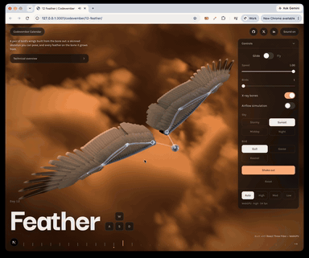</a><br>
      <b>Day 12: <a href="12-feather">Feather</a></b><br>
      <a href="12-feather">Code</a> · <a href="https://adamwebsite.com/codevember/12-feather/">Live</a>
    </td>
  </tr>
  <tr>
    <td align="center" valign="top">
      <a href="13-labyrinth">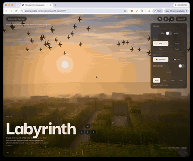</a><br>
      <b>Day 13: <a href="13-labyrinth">Labyrinth</a></b><br>
      <a href="13-labyrinth">Code</a> · <a href="https://adamwebsite.com/codevember/13-labyrinth/">Live</a>
    </td>
  </tr>
</table>

## Quick start

```bash
npm i
npm run build
npm start
```

Then open <http://localhost:3000>.

You need [Node.js](https://nodejs.org) 20.9 or newer, and a browser with WebGPU, such as a recent Chrome, Edge or Safari. Days fall back to WebGL2 where they can, with a simpler look.

## Days

| Day | Word | |
| --- | --- | --- |
| 01 | [Fold](01-fold) | A strip of countryside printed on a paper map. Fold it by its creases. |
| 02 | [Shatter](02-shatter) | Throw a stone at the sky and it comes down in pieces onto a frozen lake. |
| 03 | [Melt](03-melt) | Ray-marched liquid metal dripping into a mirror. Grab the metal and carry it around. |
| 04 | [Tangle](04-tangle) | A snarl of lacquered cord hanging in a shaft of light. Pull a loose end. |
| 05 | [Moss](05-moss) | A ledge on a cliff over a forest, deep in moss made of separate fibres. |
| 06 | [Orrery](06-orrery) | A clockwork solar system in brass. Turn the crank, or pull the Sun to break it apart. |
| 07 | [Hollow](07-hollow) | A giant peach afloat at sunrise. Slice it open and pull out the stone. |
| 08 | [Tesseract](08-tesseract) | A cube from the fourth dimension, turning itself inside out. |
| 09 | [Membrane](09-membrane) | A smooth clay skin over simple shapes, with another skin under it, for ever. Swipe and it peels away in curls that float off. |
| 10 | [Caustic](10-caustic) | Coloured glass in low sun, its light bent into bright colours on the table. |
| 11 | [Rust](11-rust) | A rusted fence post, scanned from the real thing. |
| 12 | [Feather](12-feather) | A pair of bird's wings built from the bone out, every feather on the bone it grows from. |
| 13 | [Labyrinth](13-labyrinth) | A labyrinth without end that never stops rebuilding itself. |

## Controls

| Input | Action |
| --- | --- |
| Drag | Orbit, or grab whatever is under the pointer |
| Scroll or pinch | Zoom |
| <kbd>W</kbd> <kbd>A</kbd> <kbd>S</kbd> <kbd>D</kbd> | Fly |
| <kbd>E</kbd> / <kbd>Q</kbd> | Up / down |
| <kbd>Shift</kbd> | Fly faster |
| <kbd>[</kbd> / <kbd>]</kbd> | Previous / next day |
| <kbd>H</kbd> | Hide the interface |

Every day also has its own settings panel, with quality settings that adapt to your GPU.

## Built with

- [three.js](https://threejs.org), with its WebGPU renderer and [TSL](https://github.com/mrdoob/three.js/wiki/Three.js-Shading-Language) shaders
- [React Three Fiber](https://r3f.docs.pmnd.rs), for the scene graph
- [Rapier](https://rapier.rs), through [@react-three/rapier](https://github.com/pmndrs/react-three-rapier), for physics
- [Next.js](https://nextjs.org), [React](https://react.dev) and [TypeScript](https://www.typescriptlang.org), for the site
- The Web Audio API for sound, all of it synthesised, with no audio files

## Project layout

```
01-fold/ ... 07-hollow/ One directory per day, each with a README
shared/engine/          Renderer, post-processing, camera, grabbing, boundaries, sound, settings
shared/ui/              Calendar, loading screen and on-screen controls
shared/days.ts          The 30 words, and which days are out
shared/registry.ts      Loads each day on demand
app/                    Next.js routes: the calendar at /, each day at /NN-word/
public/                 Calendar posters, and scanned textures and models
videos/                 A recording of each day, as a GIF
scripts/                Build helpers
```

## Scripts

| Command | What it does |
| --- | --- |
| `npm run dev` | Starts a development server with hot reloading |
| `npm run build` | Builds a static site into `out/`, which can be hosted anywhere |
| `npm start` | Serves the built site |
| `npm run typecheck` | Checks types |
| `npm run lint` | Runs ESLint |

## Adding a day

1. Build it in its own `NN-word/` directory, with a default export of a `DayDefinition`.
2. Add it to `shared/registry.ts`.
3. Add its blurb to `LIVE` in `shared/days.ts`.
4. Add a poster at `public/posters/NN-word.jpg`.

## Contributing

This is a personal daily challenge, so new days are mine to make, but bug reports and fixes are very welcome. Please open an issue first for anything large, and run `npm run typecheck` and `npm run lint` before sending a pull request.

## Credits

The scanned rocks, plants and moss are all CC0, from [Poly Haven](https://polyhaven.com) and [ambientCG](https://ambientcg.com). The ocean in Hollow is ported from [Ultra Water](https://github.com/Humpalumps/Ultra-Water) by Humpalumps (MIT). Everyone whose work this builds on is listed in [CREDITS.md](CREDITS.md).

## License

[MIT](LICENSE)

---

Developed with help from [Claude Opus 5.5](https://www.anthropic.com/claude) by Anthropic.
